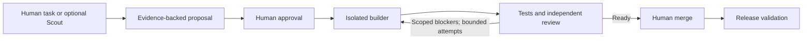

# Agent Workbench

Reusable controls for supervised agent development across side projects.

Agent Workbench separates proposals, human approval, code generation, verification,
and publication. It began as part of Sendable's development system and is evolving
here as an independent toolkit. Sendable continues to use its existing system.

**Status: development foundation (`0.1.0.dev0`).** The installable package,
offline demonstration, read-only Linear approval adapter, and local SQLite ledger
are implemented. A real sandbox approval and supervised first-pass PR have been
observed. An opt-in local coordinator now connects independent Codex verification
to bounded builder repairs, with durable reservations and a fresh review of each
new commit. It currently supports macOS and exact existing file scopes.
A GitHub Actions adapter and workflow template now wrap that same coordinator
with owner approval, live stage logs and a separate publisher. Hosted model execution
still requires a dedicated API key and a live trial; local evidence is not hosted proof.
Automatic crash recovery and release validation remain future milestones.

## Try it

Requirements: Python 3.11 or later and Git. The package has no runtime dependencies.
Installation downloads its pinned build tool; the installed demo makes no network
calls and requires no API keys.

```sh
git clone https://github.com/jackstan/agent-workbench.git
cd agent-workbench
python3 -m venv .venv
source .venv/bin/activate
python -m pip install .
agent-workbench check-config examples/demo/project.toml
agent-workbench demo
```

The demo creates a temporary Git repository containing a small slug-normalization
function and three tests. It reproduces a failure, replays a scripted approval and
builder patch, checks the allowed file scope, applies the patch, runs the tests,
and evaluates a scripted review against the exact commit. It also rejects reuse
of the same approval. The temporary repository is removed afterward.

```text
Agent Workbench — offline fixture replay
  Application tests: reproduced failure → passed after scripted patch
  Approval replay: rejected
  Change scope: src/slugify.py
  Review: pass
  Final state: ready_for_human
  Human merge remains required.
  No model calls, remote writes, deployment, or merge occurred.
```

Save the evidence to a new file:

```sh
agent-workbench demo --output demo-evidence.json --json
```

This demonstrates policy and integration wiring with real local Git/test operations.
The approval, builder, and reviewer are fixtures. It does **not** demonstrate
autonomous coding, live identity verification, PR creation, or a deployed improvement.

## What is implemented

| Component | Current behavior |
| --- | --- |
| Proposal contracts | Required evidence, criteria, tests, authenticated-adapter interface, immutable event records |
| Approval gate | Actor/proposal/repository binding, expiration/revocation checks, canonical source-decision replay protection through a consumption ledger |
| Linear adapter | Complete paginated reads, direct actor identity, full proposal/config/base binding, observed revocation and mutation checks |
| Local ledger | Atomic SQLite claims, persistent receipts and source observations, process-race and interrupted-commit tests |
| Patch policy | Approved paths, protected basenames at every depth, captured patch bytes, traversal/binary/symlink rejection, isolated index validation and atomic promotion |
| Review gate | Exact commit/base matching, complete required checks, failed checks cannot become a model PASS |
| Repair policy | Duplicate-head suppression, at most two repairs, explicit human and deployment handoffs |
| Local coordinator | Fresh authority checks, isolated Codex verification and repair, durable dispatch reservations, exact-commit re-verification; stops on uncertain outcomes |
| GitHub adapter | Owner-only dispatch, persistent Git tag claim, same-run artifacts, live stage events and a separate exact-tree publisher; hosted trial pending |
| Read recovery | Bounded transient read retries with nested deadline propagation |
| Project configuration | Versioned TOML schema, configurable identity/scope/checks, validation without execution |

## Intended delivery workflow



The diagram describes the intended complete system. The coordinator implements the
verification/repair loop. The hosted template starts from an existing candidate PR;
initial code generation and release validation are outside that template.

## Run the cycle visibly in GitHub

Copy [`examples/github/workbench.yml`](examples/github/workbench.yml) into the
consuming project's `.github/workflows/workbench.yml` and replace
`WORKBENCH_REVISION` with a reviewed full Agent Workbench commit. Commit a reviewed
`project.github.toml` and `proposal.github.json` on that project's default branch.
Use the same project schema and proposal shape as the examples, but set
`approver_actor_id = "github:YOUR_NUMERIC_USER_ID"`. Obtain that canonical ID from
GitHub's authenticated user API; do not put a username or a model-supplied ID there.

Add a dedicated `OPENAI_API_KEY` Actions secret to the consuming repository. The
template uses GitHub-hosted macOS runners for model execution and Ubuntu runners
for approval and publication. Its pinned Codex version must support named filesystem
permission profiles; every model invocation first checks the isolation boundaries.
Projects need an existing `ci.yml` with `workflow_dispatch` for the publisher to
request CI on the repaired branch.

Open a same-repository PR on an `agent/*` branch. As the configured approver, choose
**Actions → Agent Workbench → Run workflow**, select the trusted default branch,
and supply the PR number and full candidate SHA. This dispatch is a new GitHub
approval for the reviewed proposal, scope and current base. It neither consumes
nor carries forward an old Linear approval. The existing Linear/local route remains
available.

Three jobs show the run:

1. **Validate approval and reserve run:** reject stale/foreign candidates and
   atomically create a durable claim before any worker starts.
2. **Independent verifier → builder repair → fresh verifier:** emit `WORKBENCH`
   events to the live Actions log as each stage starts and completes. Findings
   pass to the builder; every repair gets a new verifier process.
3. **Validate evidence and publish for human merge:** recheck current authority,
   required checks, exact commit, cumulative patch and resulting tree; update the
   existing PR using a conditional push, publish verdicts and request CI.

The PR's pending verifier status links to the live run. Detailed stage progress
appears in Actions during execution; the final verdicts and summary appear on the
PR afterward. Download the run's artifacts for prompts, process logs, structured
reviews, patches, events and the candidate Git bundle. Artifact retention is 90 days;
export evidence needed for a longer-lived case study.

**Recovery is deliberately manual.** GitHub's Re-run button is refused. A second
dispatch of the same repository/PR/head/base/config/proposal binding is also refused,
even after runner loss. Preserve the `agent-workbench/claims/*` tags. They are durable
reservations, not an immutable audit service: trusted repository administrators can
change them. Inspect uncertain runs and remote commits before authorizing new work.
No job merges or deploys a PR.

## Run a local repair cycle

Use a reviewed installation and an **exclusively owned, disposable checkout** on the
saved authorization's branch. This command starts from an existing candidate commit.
Keep the approval ledger, authorization, and repair journal outside worker directories.
It does not consume the approval a second time. A human must explicitly authorize
continuation of that saved work.

```sh
agent-workbench cycle-init /trusted-state/cycles.sqlite
agent-workbench run-cycle /trusted/project.toml /trusted-state/authorization.json /disposable/candidate \
  --linear-config /trusted/linear.toml \
  --ledger /trusted-state/approvals.sqlite --journal /trusted-state/cycles.sqlite \
  --workspace /disposable/new-workers --evidence /trusted/new-evidence \
  --codex /absolute/path/to/codex --python /absolute/path/to/python3 \
  --issue ISSUE_UUID --proposal-comment COMMENT_UUID --head FULL_CANDIDATE_SHA
```

Use the dedicated Linear read credential described in the
[approval guide](docs/linear-approval.md). Codex uses its existing local login for
inference; worker shells receive an explicit environment, no provider credentials,
and a restricted filesystem/network profile. A mandatory probe checks selected
access denials before each model run. The adapter requires a Codex version that
supports named filesystem permission profiles; it fails if the probe fails.

The coordinator records `verification_completed → repair_reserved → repair_completed
→ verification_completed` in `events.json`, including exact commits, findings, check
results and handoff data. Full prompts, process logs, patches and model outputs are
retained alongside it. `ready_for_human` is a review result, not permission to merge.
Publication must freshly check the remote base/head and approval.

The journal admits one run per approval. A completed replay is historical evidence;
an interrupted run stays reserved and requires manual inspection. Do not delete or
replace a journal to retry uncertain work. The CLI also refuses to overwrite worker
or evidence directories. This is bounded local coordination, not unattended recovery.

### Observed sandbox repair

The [recorded local cycle](docs/evidence/sandbox-repair-cycle.json) starts from a
deliberately seeded 180-minute cap. All six original tests pass on that candidate.
A real Codex verifier reproduced `4h → 180` (expected `240`) and returned a blocker.
The coordinator reserved one repair, handed that finding to a real Codex builder,
captured its patch, and started a fresh verifier on the new commit. That verifier
passed the required suite and additional checks. Completed-run replay launched no
worker; stale review evidence was rejected.

This proves one local verifier–builder–verifier cycle, not that a builder naturally
introduced the seeded defect, that GitHub automatically triggers the loop, or that
interrupted runs recover without an operator. Public commit statuses are published
from the local evidence by the trusted operator.

Reproduce the counterexample independently from the recorded model verdicts:

```sh
git clone https://github.com/jackstan/agent-workbench-sandbox.git sandbox-proof
git -C sandbox-proof checkout --detach 89d4ab437096d0cf7fd768b97f739c77d0808490
python docs/evidence/check_duration.py sandbox-proof  # expected exit 1
git -C sandbox-proof checkout --detach 0829e3f6a13692fdf1301498edf82d9f8d0d69c4
python docs/evidence/check_duration.py sandbox-proof  # expected exit 0
```

## Reuse in another project

Start with [`examples/demo/project.toml`](examples/demo/project.toml). Configure the
repository, approver, approved paths, required checks, and repair limit. The
`check-config` command validates these settings without running any commands.

Configuration must come from a reviewed, trusted project revision. A proposal or
PR cannot grant itself permission to change protected paths. A configuration file
does not authenticate its declared approver; an approval adapter must resolve that
identity through the provider's authenticated API. The implemented Linear adapter
requires a direct human decision and a distinct app creator.

The [separate sandbox](https://github.com/jackstan/agent-workbench-sandbox) contains
a deliberately broken duration parser and predefined acceptance tests. It consumes
a pinned workbench revision without copying the engine. Follow the
[Linear approval and ledger guide](docs/linear-approval.md) to configure the first
live authorization trial. No builder or publisher is enabled by that setup.

The initial integration stack is GitHub, Linear, and Codex. Project-specific Scout
collectors will supply findings through the proposal contract. Supporting that
stack in a second project is the portability milestone.

## Development

```sh
python -m pip install -e .
python -m unittest discover -s tests -v
```

CI installs the package, runs the tests and demo on Python 3.11–3.13, and validates
a wheel installation outside the checkout. CI uses read-only repository permissions
and has no agent or provider credentials.

- [Architecture and extension boundaries](docs/architecture.md)
- [Roadmap and completion criteria](PLAN.md)
- [Source provenance](docs/origin.md)
- [Security boundaries](SECURITY.md)
- [Contributing](CONTRIBUTING.md)

A license has not been selected yet; the repository currently has no open-source license.
