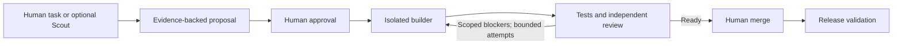

# Agent Workbench

Reusable controls for supervised agent development across side projects.

Agent Workbench separates proposals, human approval, code generation, verification,
and publication. It began as part of Sendable's development system and is evolving
here as an independent toolkit. Sendable continues to use its existing system.

**Status: development foundation (`0.1.0.dev0`).** The installable package and
offline demonstration work today. Live GitHub/Linear/Codex adapters, autonomous
execution, PR publication, and release validation are future milestones.

## Try it

Requirements: Python 3.11 or later and Git. The package has no runtime dependencies.
Installation downloads its pinned build tool; the installed demo makes no network
calls and requires no API keys.

```sh
git clone https://github.com/jackstan/agent-workbench.git
cd agent-workbench
python3 -m venv .venv
source .venv/bin/activate
python -m pip install .
agent-workbench check-config examples/demo/project.toml
agent-workbench demo
```

The demo creates a temporary Git repository containing a small slug-normalization
function and three tests. It reproduces a failure, replays a scripted approval and
builder patch, checks the allowed file scope, applies the patch, runs the tests,
and evaluates a scripted review against the exact commit. It also rejects reuse
of the same approval. The temporary repository is removed afterward.

```text
Agent Workbench — offline fixture replay
  Application tests: reproduced failure → passed after scripted patch
  Approval replay: rejected
  Change scope: src/slugify.py
  Review: pass
  Final state: ready_for_human
  Human merge remains required.
  No model calls, remote writes, deployment, or merge occurred.
```

Save the evidence to a new file:

```sh
agent-workbench demo --output demo-evidence.json --json
```

This demonstrates policy and integration wiring with real local Git/test operations.
The approval, builder, and reviewer are fixtures. It does **not** demonstrate
autonomous coding, live identity verification, PR creation, or a deployed improvement.

## What is implemented

| Component | Current behavior |
| --- | --- |
| Proposal contracts | Required evidence, criteria, tests, authenticated-adapter interface, immutable event records |
| Approval gate | Actor and proposal binding, expiration/revocation checks, repository binding, consumption-ledger interface |
| Patch policy | Approved paths, protected files, size limits, traversal/binary/symlink rejection, real Git index validation |
| Review gate | Exact commit/base matching, complete required checks, failed checks cannot become a model PASS |
| Repair policy | Duplicate-head suppression, at most two repairs, explicit human and deployment handoffs |
| Read recovery | Bounded transient read retries with nested deadline propagation |
| Project configuration | Versioned TOML schema, configurable identity/scope/checks, validation without execution |

## Intended delivery workflow



The diagram describes the intended complete system. This first milestone provides
the local policy foundation; hosted execution has not been enabled.

## Reuse in another project

Start with [`examples/demo/project.toml`](examples/demo/project.toml). Configure the
repository, approver, approved paths, required checks, and repair limit. The
`check-config` command validates these settings without running any commands.

Configuration must come from a reviewed, trusted project revision. A proposal or
PR cannot grant itself permission to change protected paths. A configuration file
does not authenticate its declared approver; a future adapter must resolve that
identity through the provider's authenticated API.

The initial integration stack is GitHub, Linear, and Codex. Project-specific Scout
collectors will supply findings through the proposal contract. Supporting that
stack in a second project is the portability milestone.

## Development

```sh
python -m pip install -e .
python -m unittest discover -s tests -v
```

CI installs the package, runs the tests and demo on Python 3.11–3.13, and validates
a wheel installation outside the checkout. CI uses read-only repository permissions
and has no agent or provider credentials.

- [Architecture and extension boundaries](docs/architecture.md)
- [Roadmap and completion criteria](PLAN.md)
- [Source provenance](docs/origin.md)
- [Security boundaries](SECURITY.md)
- [Contributing](CONTRIBUTING.md)

A license has not been selected yet; the repository currently has no open-source license.
